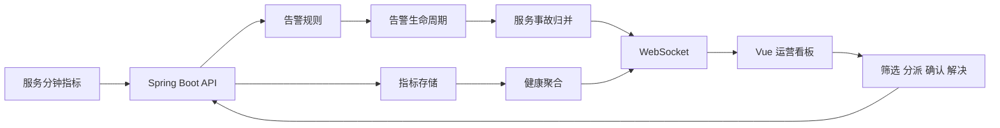

<div align="center">

# 互联网流量实时监控与数据运营平台

Spring Boot 与 Vue 构建的全栈实时数据应用，统一完成流量接入、服务健康分析和告警协同处置。

[](https://github.com/ZliY221/internet-realtime-data-operations-platform/actions/workflows/ci.yml)


[快速启动](#快速启动) · [系统架构](#系统架构) · [核心能力](#核心能力) · [项目文档](#项目文档) · [版本记录](CHANGELOG.md)

</div>

## 项目简介

平台接收互联网服务的分钟流量指标，聚合请求量、错误率和 P95 响应时间，按规则生成分级告警，并通过 WebSocket 将指标、事故和告警变化实时推送到运营看板。同一服务的关联告警会自动归并为事故，支持负责人分派、接手调查和恢复确认，形成面向服务运营的完整处置流程。

| 关注点 | 项目实现 |
| --- | --- |
| 指标接入 | 服务请求量、错误量、错误率与 P95 延迟 |
| 实时交互 | WebSocket 推送指标、告警和分派变化 |
| 告警协同 | 分级规则、级别筛选、负责人分派、状态流转 |
| 事故管理 | 同服务告警归并、事故分派、调查与恢复闭环 |
| 数据展示 | 运营 KPI、趋势图、服务健康排行和处置队列 |
| 工程运行 | H2 本地模式、PostgreSQL、Flyway、Docker Compose |

## 快速启动

需要 Java 21+、Maven 3.6.3+ 和 Node.js 20+。

终端一启动后端：

```powershell
./scripts/start-backend.ps1
```

终端二启动前端：

```powershell
./scripts/start-frontend.ps1
```

访问 `http://localhost:5173`。本地模式使用文件型 H2 数据库并生成演示指标。

使用容器启动完整环境：

```bash
docker compose up --build
```

前端地址为 `http://localhost:8088`，后端健康检查为 `http://localhost:8080/actuator/health`。

## 系统架构



## 核心能力

### 后端服务

- 使用 Spring Web 接收并校验服务分钟指标。
- 使用 Spring Data JPA 管理指标和告警持久化。
- 按错误率和响应延迟生成 WARNING、CRITICAL 告警。
- 提供服务健康聚合、告警摘要和生命周期操作接口。
- 将同一服务的活动告警归并为事故，持久化事故负责人、严重度、关联告警数和状态。

### 前端看板

- 展示近 60 分钟请求量、错误率、平均 P95 延迟和活动告警。
- 使用 ECharts 展示流量与延迟趋势。
- 按严重级别筛选告警并在表格内分派处置团队。
- 接收 WebSocket 事件后自动刷新页面数据。
- 用户可在看板提交流量样本，后端完成持久化和告警判定后实时同步到所有在线页面。
- 告警队列支持多选、后端事务化批量确认和批量解决，操作结果继续通过实时通道同步。
- 告警队列支持按服务、级别和负责人组合筛选，实时事件到达后保持当前筛选上下文。
- 服务健康列表可一键进入单服务视图，趋势图与告警队列同步聚焦对应服务。
- 当前聚焦服务在列表中高亮，可再次点击或使用趋势区按钮快速恢复全部服务。
- 聚焦单服务时，请求量、错误率、P95 延迟、活动告警和活跃服务数同步切换为该服务口径。
- 勾选多条告警后可一次性分派给同一值班团队，并实时同步到其他在线页面。
- 新版统一处置可在一次事务中完成告警分派与确认，并只发送一次实时广播。
- 统一处置提交前预览严重级别、分派数量和状态变化数量，高风险操作要求二次确认。
- 统一处置回执区分实际更新与幂等跳过，无变化时不发送多余实时广播。
- 统一处置结果同步返回严重与警告告警数量，工作台实时显示处置风险构成。
- 统一处置回执统计操作前各状态数量，便于判断本次状态推进覆盖范围。
- 执行回执明确区分完整更新、部分更新与无变化三种结果。
- 处置后按严重度安排 1/4 小时复核窗口，并生成可直接交接的处置摘要。
- 将严重告警标记为 P0、其他变更标记为 P1，无变化标记为无需复核。
- 根据处置动作和风险影响生成升级负责人、验证恢复或持续观察建议。
- 为每次处置生成回执核对、负责人联系、建议执行和结果登记清单。
- 事故中心把关联告警聚合为服务级工作项，支持值班人员接手、分派和恢复确认。

### 数据与部署

- 使用 Flyway 管理数据库增量迁移和索引。
- 本地模式使用 H2，容器环境使用 PostgreSQL。
- Docker Compose 编排数据库、后端和前端服务。
- GitHub Actions 构建后端、运行工程验证并生成前端生产包。

## 工程结构

```text
backend/       Spring Boot API、规则、WebSocket 和数据库迁移
frontend/      Vue 3、TypeScript 与 ECharts 运营看板
docs/          架构、接口和运行文档
scripts/       本地启动与统一验证入口
compose.yaml   PostgreSQL、后端与前端编排
```

## 常用入口

| 目标 | 命令或入口 |
| --- | --- |
| 启动后端 | `./scripts/start-backend.ps1` |
| 启动前端 | `./scripts/start-frontend.ps1` |
| 工程验证 | `./scripts/verify.ps1` |
| 容器部署 | `docker compose up --build` |
| 健康检查 | `GET /actuator/health` |
| 告警查询 | `GET /api/v1/alerts` |
| 事故查询 | `GET /api/v1/incidents` |

## 项目文档

- [用户使用指南](docs/user-guide.md)
- [运行环境分层](docs/runtime-environments.md)
- [系统架构](docs/architecture.md)
- [接口说明](docs/api.md)
- [本地开发](docs/local-development.md)
- [版本记录](CHANGELOG.md)
- [版本摘要](VERSION_LOG.md)

## 运行边界

- 内置指标模拟器仅用于本地展示，生产接入时应关闭。
- 告警规则用于演示可配置处置链路，不替代生产监控平台的完整策略体系。
- 指标与告警正文不应携带个人信息、访问凭据或原始请求内容。

## 版本与维护

当前版本为 `v3.5.0`。平台新增值班操作旅程演练，通过 100 条事故处置场景检查指标、告警确认、负责人、依赖边界和恢复门禁，为值班人员提供连续且可确认的下一步操作。每次发布同步维护[用户使用指南](docs/user-guide.md)、[版本记录](CHANGELOG.md)和[版本摘要](VERSION_LOG.md)。

## License

MIT
